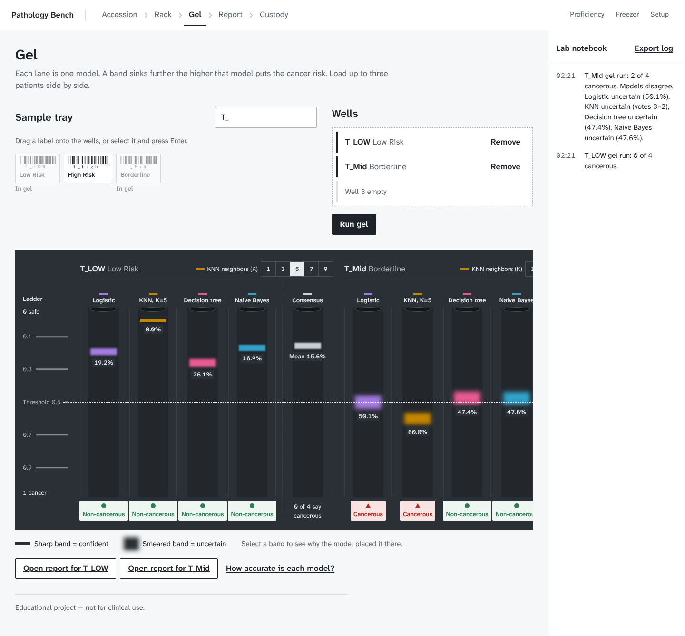
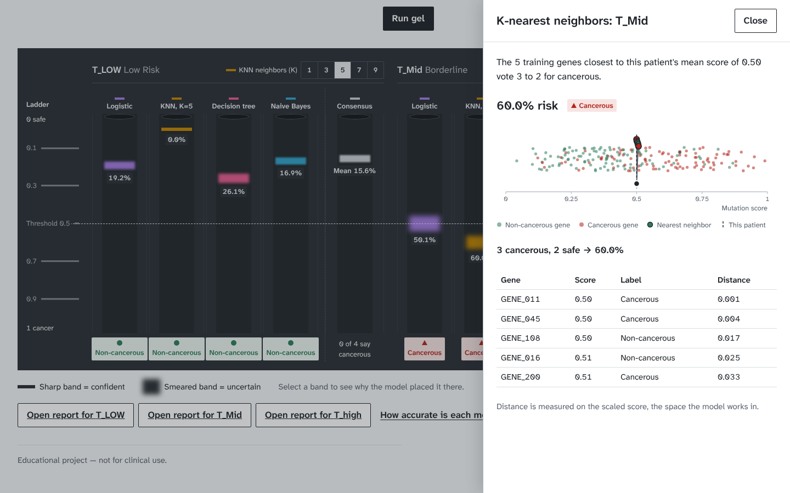
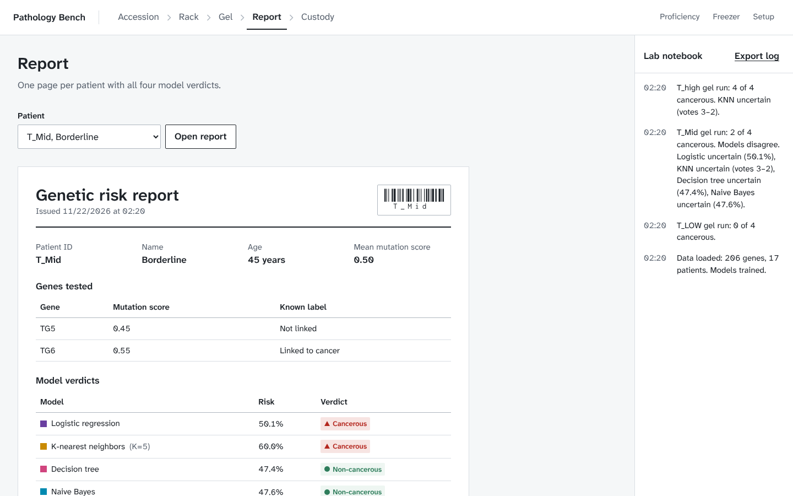
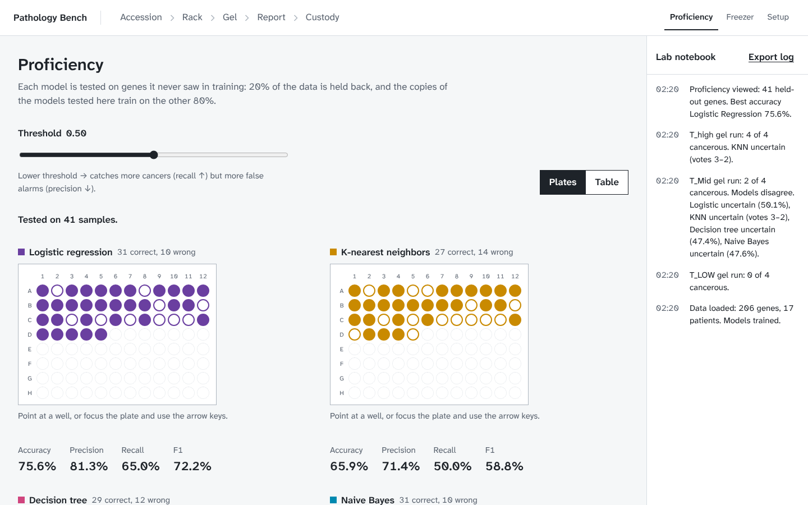
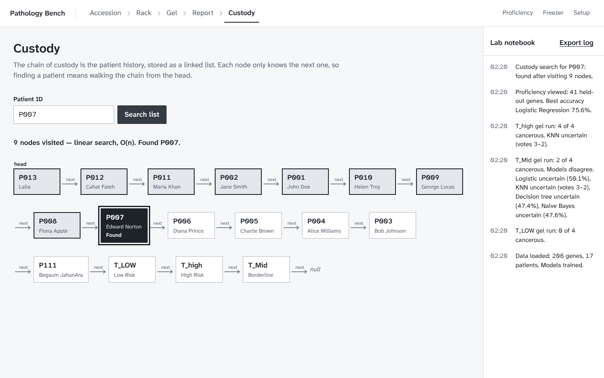
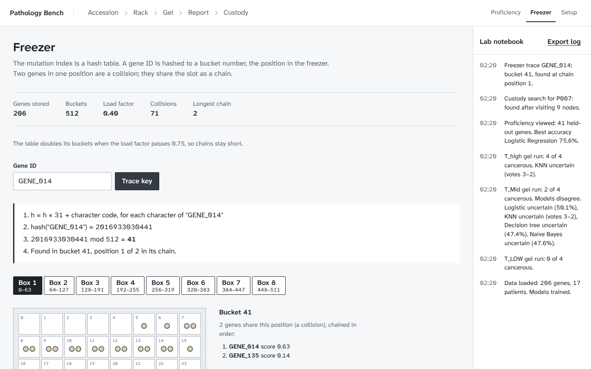

# 🔬 Cancer Diagnosis System

> **Cancer risk from genetic mutation scores with four machine learning models written from scratch in C++, and a React interface designed as a pathology lab bench.**

[](https://en.cppreference.com/)
[](https://cmake.org/)
[](https://react.dev/)
[](LICENSE)

> **Educational project — not for clinical use.**



## 📋 Table of Contents

- [Overview](#-overview)
- [Features](#-features)
- [Design: the Pathology Bench](#-design-the-pathology-bench)
- [Tech Stack](#️-tech-stack)
- [Getting Started](#-getting-started)
- [Usage](#-usage)
- [Project Structure](#-project-structure)
- [API Documentation](#-api-documentation)
- [Machine Learning Models](#-machine-learning-models)
- [Data Structures](#-data-structures)
- [Data Format](#-data-format)
- [Screenshots](#-screenshots)
- [License](#-license)
- [Author](#-author)

## 🎯 Overview

The **Cancer Diagnosis System** predicts whether a patient's genes point to cancer. Each
patient has a few genes with a mutation score from 0 to 1. The models look at the
patient's mean mutation score and return a risk between 0 and 1.

The project has two parts:

- A **C++17 HTTP server** (`cds_server`, port 8080) with four models implemented from
  scratch and the data structures the course asks for, each used for a real job.
- A **React frontend** (`frontend/`) that shows every result and explains how each model
  reached it.

### Key Highlights

- 🧠 **Four models from scratch**: Logistic Regression, K-Nearest Neighbors, Decision Tree and Naive Bayes
- 🧪 **Explained predictions**: for every model you can see the numbers behind its answer
- 📊 **Honest evaluation**: metrics on a held-out 20% split the evaluated models never trained on
- 🧱 **Data structures you can see**: queue as a tube rack, linked list as a chain of custody, hash table as a freezer index

## ✨ Features

- **Gel**: run up to three patients through all four models at once; disagreement and uncertainty are visible at a glance
- **Why drawer**: KNN neighbours, the decision-tree path, the logistic-regression formula and the Naive Bayes bell curves, all with real numbers
- **KNN K control**: change K (1–9) for one request and watch the KNN band move
- **Accession**: add a patient with genetic records; the models retrain with the new genes
- **Rack**: the test queue (FIFO), processed tube by tube
- **Report**: a printable one-page report per patient with all four verdicts and a "models disagree" flag
- **Proficiency**: one 96-well plate per model, and a threshold dial that recomputes accuracy, precision, recall and F1
- **Custody**: linear search through the patient linked list, node by node
- **Freezer**: the hash table's buckets and a step-by-step trace of where a gene ID is stored
- **Lab notebook**: a log of real events with times, exportable as `.txt`

## 🧫 Design: the Pathology Bench

The interface looks and behaves like a genetics lab bench. Every screen is a lab tool, and
the program's data structures appear as lab objects:

| Program | Lab object | Screen |
|---|---|---|
| Model predictions | Gel electrophoresis | Gel |
| Test queue (FIFO) | Tube rack and analyzer | Rack |
| Patient history (linked list) | Chain of custody | Custody |
| Mutation map (hash table) | Freezer box index | Freezer |
| Evaluation on held-out data | Proficiency test plates | Proficiency |

**The gel is the one bold element.** Its vertical axis is risk: 0 (safe) at the top, 1
(cancer) at the bottom, with a dashed threshold line at 0.5. A sharp band means the model
is confident; a smeared band means it is unsure (band height and blur grow as the risk
gets closer to 0.5). When a gel runs, the bands migrate from the wells to their position;
with reduced motion turned on they simply appear in place.

**Stain colors identify models only**, named after real histology stains:

| Model | Stain | Light surfaces | On the gel |
|---|---|---|---|
| Logistic Regression | Hematoxylin | `#6A3FA0` | `#A47BE1` |
| KNN | DAB amber | `#C98A00` | `#C48600` |
| Decision Tree | Eosin | `#D0457E` | `#E75A91` |
| Naive Bayes | Methylene blue | `#0089B0` | `#31A1C9` |

Outcomes have their own colors (`#2E7D5B` non-cancerous, `#B3261E` cancerous) and always
come with a word and an icon. The gel colors are lighter steps of the same hues, checked
for color-blind separation and 3:1 contrast on the dark gel surface. Every lane, plate and
legend also prints the model name as text, so no information depends on color alone.
All values are in [`frontend/src/styles/tokens.css`](frontend/src/styles/tokens.css).

Type is Atkinson Hyperlegible Next throughout (a typeface designed for legibility), with
Libre Barcode 128 only on specimen labels, which carry a valid Code 128 barcode of the
patient ID.

## 🛠️ Tech Stack

### Backend
- **Language**: C++17
- **HTTP server**: [cpp-httplib](https://github.com/yhirose/cpp-httplib) v0.28.0 (single header in `third_party/`)
- **Build**: CMake 3.10+
- Thread-safe: every request handler locks one mutex around the shared system object

### Frontend
- **React 18** with **Vite**, React Router
- **framer-motion** (gel migration, drawer), **@dnd-kit/core** (drag samples onto the gel), **d3-scale** (scales only; every chart is hand-drawn SVG)
- CSS Modules and one `tokens.css`; fonts from `@fontsource`

## 🚀 Getting Started

### Prerequisites

- **CMake** 3.10 or higher
- **C++17 compiler**: Visual Studio 2019+ or MinGW (Windows), GCC (Linux), Xcode Command Line Tools (macOS)
- **Node.js 18** or newer (for the frontend)

### 1. Clone

```bash
git clone https://github.com/Abdulrahman10724/Cancer-Diagnosis-System.git
```

```bash
cd Cancer-Diagnosis-System
```

### 2. Build the server

**Linux / macOS**
```bash
mkdir build && cd build
cmake .. -DCMAKE_BUILD_TYPE=Release
cmake --build .
```

**Windows (Visual Studio)**
```bash
mkdir build && cd build
cmake .. -G "Visual Studio 16 2019"
cmake --build . --config Release
```

**Windows with MinGW (MSYS2)**
```bash
mkdir build && cd build
cmake .. -G "MinGW Makefiles"
cmake --build .
# Executable: build\cds_server.exe
```

### 3. Run the server

Always run it from the project root, so it finds the `data/` folder:

```bash
./build/cds_server               # Linux/macOS
.\build\Release\cds_server.exe   # Windows (Visual Studio)
.\build\cds_server.exe           # Windows (MinGW)
```

### 4. Run the frontend

In a second terminal:

```bash
cd frontend
npm install
npm run dev
```

Open the URL Vite prints (normally http://localhost:5173). On the **Setup** screen, choose
**Load data**. The server reads the CSV files and trains the four models.

The frontend talks to `http://localhost:8080` by default. To use another address, change
it on the Setup screen, or set `VITE_API_URL` before `npm run dev`.

Other scripts: `npm run build` (production build in `frontend/dist/`) and `npm run lint`.

For more detail and troubleshooting, see [SETUP_GUIDE.md](SETUP_GUIDE.md).

## 📖 Usage

1. **Setup**: load the data (trains the models).
2. **Accession**: add a patient with their genes. The models retrain.
3. **Gel**: drag specimen labels onto the wells (or select one and press Enter), then
   **Run gel**. Select a band to see why the model placed it there.
4. **Rack**: add tubes, pick a model and **Process rack**.
5. **Report**: open the one-page report and **Print report**.
6. **Proficiency**, **Custody** and **Freezer**: see how accurate each model is and how the
   data structures work.

## 📁 Project Structure

```
Cancer-Diagnosis-System/
├── data/
│   ├── genes.csv              # Genetic records: Gene_ID, Mutation_Score, Label
│   ├── patients.csv           # Patients: Patient_ID, Name, Age
│   ├── patient_genes.csv      # Which genes belong to which patient
│   └── test_*.csv             # Extra test datasets
├── headers/                   # C++ headers (models, data structures, system)
├── src/                       # C++ sources; Server.cpp is the HTTP API
├── third_party/httplib.h      # cpp-httplib
├── frontend/                  # React app
│   └── src/
│       ├── api/client.js      # The only place that calls the server
│       ├── state/AppState.jsx # App state (Context + useReducer)
│       ├── styles/            # tokens.css, global.css
│       ├── components/        # SpecimenLabel, Band, Lane, Well, Plate, Tube, Drawer, …
│       ├── screens/           # Setup, Accession, Rack, Gel, Report, Proficiency, Custody, Freezer
│       └── lib/               # metrics.js, format.js, models.js, code128.js, hash.js
├── docs/screenshots/
├── generate_genes.py          # Generates a realistic genes.csv
├── main.cpp                   # Optional command-line version
├── CMakeLists.txt
├── SETUP_GUIDE.md
└── README.md
```

## 🔌 API Documentation

The server listens on `http://localhost:8080`. Every response carries
`Access-Control-Allow-Origin: *`. Errors are JSON: `{"error":"..."}`, with `400` for bad
input or when no data is loaded (`{"error":"Load data first"}`), `404` for unknown IDs and
`409` for a duplicate patient ID.

| Method | Path | Purpose |
|---|---|---|
| GET | `/status` | `modelsTrained`, `geneticCount`, `patientCount` |
| POST | `/load` | Load CSV files and train. Body: `{"genesFile":"data/genes.csv","patientsFile":"data/patients.csv"}` (optional `patientGenesFile`) |
| GET | `/patients` | Patients in linked-list order (head first), with `riskScore`, `prediction` and their `genes` |
| POST | `/patients` | Add a patient: `{"patient_id","name","age","geneticRecords":[{"geneId","mutationScore","label"}]}`. Retrains, saves the CSV files |
| GET | `/patients/search?id=ID` | Linear search of the linked list |
| GET | `/genetic` | All genetic records |
| GET | `/diagnose?patient_id=ID&model=M&k=K` | Diagnose one patient |
| GET | `/evaluate` | Metrics on a held-out 20% split, with per-sample data |
| GET | `/hashmap` | Buckets of the mutation hash table |
| GET | `/queue` | Queued patient IDs, front first |
| POST | `/queue` | Add a patient to the rear: `{"patient_id":"P001"}` |
| POST | `/queue/process` | Process the whole queue: `{"model":"logistic"}` |

### `GET /diagnose`

`model` is `logistic`, `knn`, `decision_tree`, `naive_bayes` (single model, returns
`{"patient_id","riskScore","prediction"}`) or `all`. `k` is optional (odd, 1–15, default 5)
and changes K for KNN for this request only.

`model=all` returns all four models with the numbers behind each answer:

```json
{
  "patient_id": "P007",
  "featureRaw": 0.52578,
  "featureScaled": 0.179608,
  "scale": { "mean": 0.487289, "std": 0.214304 },
  "geneCount": 5,
  "threshold": 0.5,
  "models": {
    "logistic": { "risk": 0.529, "prediction": 1, "explain": { "weight": 0.9475, "bias": -0.0531, "z": 0.117 } },
    "knn": { "risk": 0.6, "prediction": 1, "k": 5,
             "explain": { "neighbors": [ { "gene_id": "GENE_076", "mutation_score": 0.5215, "label": 0, "distance": 0.02 } ],
                          "votesCancer": 3, "votesSafe": 2 } },
    "decision_tree": { "risk": 0.0, "prediction": 0,
                       "explain": { "path": [ { "threshold": 0.527, "thresholdScaled": 0.1855, "wentLeft": true, "positiveFraction": 0.485, "samples": 206 } ],
                                    "leafPositiveFraction": 0.0, "leafSamples": 3 } },
    "naive_bayes": { "risk": 0.514, "prediction": 1,
                     "explain": { "safe": { "mean": -0.46, "std": 0.83, "prior": 0.51 },
                                  "cancer": { "mean": 0.49, "std": 0.94, "prior": 0.49 } } }
  },
  "consensus": { "cancer": 3, "safe": 1 }
}
```

`featureRaw` is the patient's mean mutation score (what the models see), `featureScaled`
the same value after standardization. KNN neighbour `mutation_score` values are raw;
`distance` is measured in the scaled space the model uses. Decision-tree `threshold` is on
the raw score scale and `thresholdScaled` is the value the tree actually compares.

### `GET /evaluate`

The genetic data is split 80% train / 20% test, stratified by label, with a fixed seed.
Temporary copies of the models train on the 80% and are measured on the 20%; the models
used by `/diagnose` stay trained on all the data. Predictions use `risk >= 0.5`.

```json
{
  "testSamples": 41,
  "models": [
    { "key": "logistic", "name": "Logistic Regression",
      "accuracy": 0.7561, "precision": 0.8125, "recall": 0.65, "f1": 0.7222,
      "confusion": { "tp": 13, "fp": 3, "tn": 18, "fn": 7 },
      "samples": [ { "gene_id": "GENE_001", "mutation_score": 0.3633, "label": 0, "risk": 0.3503 } ] }
  ]
}
```

The frontend recomputes the metrics for other thresholds from `samples`.

### `GET /hashmap`

```json
{ "bucketCount": 512, "size": 206, "loadFactor": 0.4023,
  "buckets": [ { "index": 0, "items": [] },
               { "index": 7, "items": [ { "key": "GENE_001", "value": 0.3633, "hash": 2016933030407 },
                                         { "key": "GENE_122", "value": 0.4271, "hash": 2016933031431 } ] } ] }
```

Hash values above 2^53 lose precision as JSON numbers in JavaScript; the frontend
recomputes the exact hash with `BigInt` (`frontend/src/lib/hash.js`).

### `GET /patients/search?id=ID`

```json
{ "found": true, "hops": 9, "order": ["P013","P012","P011","P002","P001","P010","P009","P008","P007"] }
```

`order` lists every node visited from the head, in order.

## 🤖 Machine Learning Models

All four use one feature: the patient's mean mutation score, standardized with the mean
and standard deviation of the training genes.

- **Logistic Regression**: gradient descent on log loss (learning rate 0.01, 1000 iterations); risk = σ(w·x + b).
- **K-Nearest Neighbors**: Euclidean distance; risk = share of the K nearest training genes labelled cancerous (K = 5 by default).
- **Decision Tree**: Gini impurity, maximum depth 10; risk = share of cancerous training genes in the leaf the patient reaches.
- **Naive Bayes**: one Gaussian per class plus the class prior; risk = posterior probability of the cancerous class.

## 🧱 Data Structures

- **Linked list** (`PatientNode`): patient history. Searching walks the list from the head, O(n).
- **Queue** (`std::queue<Patient>`): test requests, first in, first out.
- **Hash table** (`HashMapper`): gene ID → mutation score. A separate-chaining hash table
  implemented in this project: a vector of buckets, each a linked list of (key, value)
  pairs; polynomial rolling hash `h = h * 31 + c` (unsigned 64-bit) modulo the bucket
  count; starts with 16 buckets and doubles when the load factor passes 0.75.
- **Vector**: the genetic records used for training.

## 📊 Data Format

### genes.csv
```csv
Gene_ID,Mutation_Score,Label
GENE_001,0.3633,0
GENE_003,0.7553,1
```

### patients.csv
```csv
Patient_ID,Name,Age
P001,John Doe,45
```

### patient_genes.csv
Links each patient to its own genes by `Gene_ID`. The server writes it whenever it saves.
If the file does not exist, each patient is given 5 consecutive genes from `genes.csv`.
```csv
Patient_ID,Gene_ID
P001,GENE_001
P001,GENE_002
```

## 🎨 Screenshots

| | |
|---|---|
|  |  |
|  |  |
|  | |

## 📝 License

This project is licensed under the MIT License - see the [LICENSE](LICENSE) file for details.

## 👤 Author

Abdul Rahman — https://github.com/Abdulrahman10724
