# 🔬 Cancer Diagnosis System

> **A cancer-risk pipeline built on data structures: four models written from scratch in C++, every step running on a hand-written data structure, and a React app you ride through like a metro line.**

[](https://en.cppreference.com/)
[](https://cmake.org/)
[](https://react.dev/)
[](LICENSE)

> **Student project — not for real medical use.**

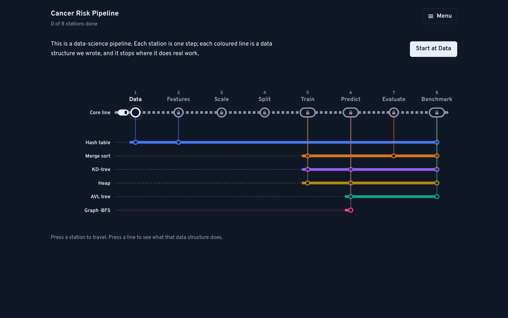

## 📋 Table of Contents

- [Overview](#-overview)
- [Features](#-features)
- [Design](#-design)
- [Tech Stack](#️-tech-stack)
- [Getting Started](#-getting-started)
- [Usage](#-usage)
- [Project Structure](#-project-structure)
- [API Documentation](#-api-documentation)
- [Machine Learning Models](#-machine-learning-models)
- [Data Structures](#-data-structures)
- [Data Format](#-data-format)
- [Screenshots](#-screenshots)
- [License](#-license)
- [Author](#-author)

## 🎯 Overview

The **Cancer Diagnosis System** predicts whether a patient's genes point to cancer. Each
patient has a few genes with a mutation score from 0 to 1. Each patient is turned into four
features (average mutation score, highest mutation score, number of high-risk genes, age),
and four models each return a risk between 0 and 1.

The project has two parts:

- A **C++17 HTTP server** (`cds_server`, port 8080) with four models implemented from
  scratch and the data structures the course asks for, each used for a real job.
- A **React frontend** (`frontend/`), “Night Metro”: the pipeline drawn as a metro map. Each
  station is a pipeline step, each coloured line is a data structure, and a line stops at a
  station where that structure does real work.

### Key Highlights

- 🧠 **Four models from scratch**: Logistic Regression, K-Nearest Neighbors, Decision Tree and Naive Bayes
- 🧪 **Explained predictions**: for every model you can see the numbers behind its answer
- 📊 **Honest evaluation**: metrics on a held-out 20% split the evaluated models never trained on
- 🧱 **Hand-written data structures doing real work**: hash table, linked list, KD-tree, binary heap, merge sort with prefix sums, AVL trees, a similarity graph with BFS, and an undo stack — with a `/benchmark` endpoint that measures them against simpler alternatives
- 📚 **Docs**: [API reference](docs/API.md) and [data structures and algorithms](docs/DSA.md)

## ✨ Features

The app is a journey through eight stations, travelled in order. A station unlocks when the
one before it is finished by a real action (loading data, splitting, opening every model…),
and you can always go back. Progress is kept in the browser; switching datasets restarts
stations 2 to 8, because every result changes.

| # | Station | What you do | Lines (data structures) |
|---|---|---|---|
| 1 | Data | Load the sample dataset, upload your own three CSVs (with a preview and a list of every problem if a file is wrong) or pick a saved upload; browse the patients; see a gene ID hashed into its bucket | Hash table, core |
| 2 | Features | Pick a patient and watch their genes become four numbers; compare cancer and no-cancer histograms; read the correlation heatmap | Hash table, core |
| 3 | Scale | Switch the four rulers from raw values to z-scores | Core |
| 4 | Split | Shuffle 400 patients into a stratified 320 / 80 split, then into 5 folds with real fold scores | Core (shuffle) |
| 5 | Train | Logistic weights, the KNN KD-tree and K, the decision tree’s questions, Naive Bayes’ bell curves | Merge sort, KD-tree, heap |
| 6 | Predict | Diagnose a patient (four bars, a 50% cancer line, a vote, and “Why?” per model); add, delete and undo patients; a queue and a triage heap side by side; linked list vs AVL search; the similarity graph with a BFS wave | KD-tree, heap, AVL tree, graph · BFS, core |
| 7 | Evaluate | Accuracy, precision, recall, F1 and a 2×2 table in words; a threshold slider recomputed in the browser; ROC curves with AUC; 5-fold cross-validation | Merge sort, core |
| 8 | Benchmark | A departure board: the simple way vs our structure at 2,000 or 20,000 patients | Every line |

The landing page explains the idea in one screen and shows three measured speed-ups.

## 🎨 Design

- **One idea per screen**: every station has one sentence, one main panel and one main
  action; extra parts sit in tabs or a drawer.
- **Colour means a data structure.** Six line colours (hash table, merge sort, KD-tree, heap,
  AVL tree, graph · BFS) plus the grey core line, always shown with their name. Checked
  with the dataviz palette validator on both surfaces: on the night map
  `#4778F5 #DB7618 #9460E8 #10A58C #B38A12 #EA4D82` (all checks pass), on the light pages
  `#2F6BFF #FF8A00 #8E44EC #00A88F #C49A00 #F0436A` (pass; orange and gold are below 3:1
  on white, so they never appear without their name).
- **Models are not coloured**: they are told apart by ink shade, dash pattern and name, so a
  colour never means two things. Diagnosis is dark ink (cancer) vs grey (no cancer).
- **Outcomes** (✓ Low risk, ! Borderline, ▲ High risk; right / wrong) use their own green,
  amber and red, always with an icon and a word.
- **Type**: Overpass for everything (a typeface from highway signage), Overpass Mono only
  for the benchmark board and the hash formula. Tabular figures for numbers.
- **Motion explains**: the map draws its lines once per session, the train glides to the
  next station when it unlocks, bars grow and numbers count up only after an action, and
  the benchmark board flips its digits in. With reduced motion on, everything appears at once.
- **Accessible**: keyboard access to every station, line and control; visible focus; drawers
  trap focus and close on Esc; verdicts and unlocks are announced; works down to 390px wide
  (the map turns vertical).

## 🛠️ Tech Stack

### Backend
- **Language**: C++17
- **HTTP server**: [cpp-httplib](https://github.com/yhirose/cpp-httplib) v0.28.0 (single header in `third_party/`)
- **Build**: CMake 3.10+
- Thread-safe: every request handler locks one mutex around the shared system object
- No STL containers beyond `vector`/`string`: every map, set, queue, stack, heap and sort is written by hand

### Frontend
- **React 18** with **Vite**, React Router
- **framer-motion** (all animation), **d3-scale** and **d3-shape** (scales and paths; every chart is hand-drawn SVG), **d3-force** (layout of the similarity graph only)
- CSS Modules and one `tokens.css`; Overpass and Overpass Mono from `@fontsource`; icons drawn as inline SVG
- `src/api/client.js` is the only place that calls the server

## 🚀 Getting Started

### Prerequisites

- **CMake** 3.10 or higher
- **C++17 compiler**: Visual Studio 2019+ or MinGW (Windows), GCC (Linux), Xcode Command Line Tools (macOS)
- **Node.js 18** or newer (for the frontend)

### 1. Clone

```bash
git clone https://github.com/Abdulrahman10724/Cancer-Diagnosis-System.git
```

```bash
cd Cancer-Diagnosis-System
```

### 2. Build the server

**Linux / macOS**
```bash
mkdir build && cd build
cmake .. -DCMAKE_BUILD_TYPE=Release
cmake --build .
```

**Windows (Visual Studio)**
```bash
mkdir build && cd build
cmake .. -G "Visual Studio 16 2019"
cmake --build . --config Release
```

**Windows with MinGW (MSYS2)**
```bash
mkdir build && cd build
cmake .. -G "MinGW Makefiles"
cmake --build .
# Executable: build\cds_server.exe
```

### 3. Run the server

Always run it from the project root, so it finds the `data/` folder:

```bash
./build/cds_server               # Linux/macOS
.\build\Release\cds_server.exe   # Windows (Visual Studio)
.\build\cds_server.exe           # Windows (MinGW)
```

### 4. Run the frontend

In a second terminal:

```bash
cd frontend
npm install
npm run dev
```

Open the URL Vite prints (normally http://localhost:5173), press **Start the journey**, then
**Start at Data** on the map and **Load dataset**.

The frontend talks to `http://localhost:8080` by default. To use another address, set
`VITE_API_URL` before `npm run dev`, or change it on the map under **Menu → Server address**.

Other scripts: `npm run build` (production build in `frontend/dist/`) and `npm run lint`.

For more detail and troubleshooting, see [SETUP_GUIDE.md](SETUP_GUIDE.md).

### 5. Run the tests

The build also makes `cds_tests` (unit tests for every data structure and model). From the
`build` folder:

```bash
ctest --output-on-failure
```

With Visual Studio add the configuration: `ctest -C Release --output-on-failure`.

### 6. Generate a dataset (optional)

`cds_datagen` writes the three CSV files of a synthetic dataset:

```bash
./build/cds_datagen --patients 400 --genes 800 --seed 42 --noise 0.10 --out data --force
```

| Option | Default | Meaning |
|---|---|---|
| `--patients N` | 400 | number of patients |
| `--genes N` | 800 | number of genes |
| `--seed N` | 42 | random seed (the same seed gives the same files on every compiler) |
| `--noise X` | 0.10 | share of diagnoses flipped at random |
| `--out DIR` | `data` | output folder |
| `--force` | off | overwrite existing files |

The command above recreates the default dataset in `data/`. Datasets can also be uploaded
through `POST /upload` and switched with `POST /datasets/select`.

## 📖 Usage

1. **Landing page** (`/`): the idea in one screen. **Start the journey** opens the map.
2. **Map** (`/map`): press a station to travel there, or a line to see what that data
   structure does and where. Locked stations show a lock and say what to finish first.
   **Menu** holds **Reset journey** and the server address.
3. **Stations** (`/station/data` … `/station/benchmark`): each one says what happens there
   in one sentence, has one main panel, and shows the lines that stop there. The bar at the
   top is a small map; **Next station** unlocks when the station is finished.
4. **Benchmark**: the 20,000-patient board takes about 20 seconds on the server.

## 📁 Project Structure

```
Cancer-Diagnosis-System/
├── data/
│   ├── genes.csv              # Genes: Gene_ID, Mutation_Score
│   ├── patients.csv           # Patients: Patient_ID, Name, Age, Diagnosis
│   ├── patient_genes.csv      # Which genes belong to which patient
│   ├── uploads/<name>/        # Uploaded datasets (created by POST /upload)
│   └── test_*.csv             # Old-format files, not used by the server
├── headers/                   # C++ headers (models, data structures, system)
├── src/                       # C++ sources; Server.cpp is the HTTP API
├── tests/test_main.cpp        # Unit tests (cds_tests, run with ctest)
├── tools/generate_data.cpp    # Dataset generator (cds_datagen)
├── third_party/httplib.h      # cpp-httplib
├── frontend/                  # React app
│   └── src/
│       ├── api/client.js      # The only place that calls the server
│       ├── state/Journey.jsx  # Journey progress, locks, toasts (saved as cds.journey.v1)
│       ├── styles/            # tokens.css (Night Metro palette), global.css
│       ├── components/        # MetroDiagram, MetroBar, StationLayout, Tabs, Drawer, SplitFlap, …
│       ├── screens/           # Landing, MapPage
│       ├── stations/          # Data, Features, Scale, Split, Train, Predict (+ predict/), Evaluate, Benchmark
│       └── lib/               # metro.js (stations and lines), geometry.js, hash.js (BigInt hash), …
├── docs/
│   ├── API.md                 # Every endpoint with request and response
│   ├── DSA.md                 # Data structures, complexities, benchmark results
│   └── screenshots/
├── generate_genes.py          # Old genes.csv generator (kept; replaced by cds_datagen)
├── main.cpp                   # Old command-line version (not built)
├── CMakeLists.txt
├── SETUP_GUIDE.md
└── README.md
```

## 🔌 API Documentation

The full reference with request and response shapes is in **[docs/API.md](docs/API.md)**.
The server listens on `http://localhost:8080`; every response, errors included, carries
`Access-Control-Allow-Origin: *`. Errors are `{"error":"..."}` with `400` (bad input, no data,
invalid dataset — then also `"problems":[...]`), `404` (unknown ID) or `409` (duplicate).

| Method | Path | Purpose |
|---|---|---|
| GET | `/status` | Active dataset, counts, whether the models are trained |
| POST | `/load` | Load CSV files by path |
| POST | `/upload` | Upload a dataset as CSV text; validated, saved to `data/uploads/<name>/`, loaded |
| GET | `/datasets` | `default` and every uploaded dataset, with counts |
| POST | `/datasets/select` | Switch to another dataset |
| GET / POST | `/patients` | List patients / add one (retrains and saves) |
| DELETE | `/patients/{id}` | Delete a patient |
| POST | `/undo` | Undo the last add or delete |
| GET | `/patients/search`, `/patients/index`, `/patients/range` | Linked-list search, AVL ID lookup, AVL risk range |
| GET | `/genetic` | All genes |
| GET | `/diagnose` | One model or all four, with explanations |
| GET | `/evaluate`, `/crossval` | 80/20 test metrics with ROC/AUC; k-fold cross-validation |
| GET | `/features`, `/tree`, `/kdtree` | Feature statistics and correlation; the decision tree; the KD-tree |
| GET / POST | `/queue`, `/queue/process` | FIFO waiting list |
| GET / POST | `/triage`, `/triage/process` | Priority queue by risk (binary heap) |
| GET | `/graph`, `/graph/bfs` | Patient similarity graph, components and BFS |
| GET | `/hashmap` | Buckets of the gene hash table |
| GET | `/benchmark?n=2000&seed=1` | Timings of the data structures against simpler alternatives |

## 🤖 Machine Learning Models

Every patient becomes four features (`src/FeatureExtractor.cpp`):

| Feature | Meaning |
|---|---|
| `avgMutation` | mean mutation score of the patient's genes |
| `maxMutation` | highest mutation score |
| `highRiskGenes` | number of genes with a score of 0.7 or more (`HIGH_RISK_CUTOFF`) |
| `age` | the patient's age |

Each feature is standardized with its own mean and standard deviation from the training
patients. The four models train on the labelled patients:

- **Logistic Regression**: gradient descent on log loss (learning rate 0.1, 2000 iterations), one weight per feature; risk = σ(w·x + b).
- **K-Nearest Neighbors**: K = 5, neighbours found with a KD-tree; risk = share of the K nearest patients with cancer.
- **Decision Tree**: Gini impurity, maximum depth 5, minimum 4 patients to split, split search with merge sort and prefix sums.
- **Naive Bayes**: one Gaussian per feature and class plus the class prior; risk = posterior probability of cancer.

On the default dataset (80/20 stratified split, seed 42): logistic regression 0.800 accuracy
(AUC 0.828), KNN 0.762 (0.820), decision tree 0.838 (0.839), Naive Bayes 0.787 (0.841).
5-fold cross-validation and the details are in [docs/DSA.md](docs/DSA.md).

## 🧱 Data Structures

All written by hand; [docs/DSA.md](docs/DSA.md) gives where each is used, why, the
complexity of every operation and measured benchmark numbers.

- **Linked list**: the patient list in insertion order
- **Hash table** (separate chaining, rehash at load factor 0.75): gene ID → mutation score
- **KD-tree**: KNN neighbour search and graph edge search
- **Binary heap**: KNN top-K and the triage priority queue
- **Merge sort + prefix sums**: decision-tree split search
- **AVL trees**: patient ID index and risk range index
- **Graph + BFS**: patient similarity clusters
- **Stack**: undo (up to 50 steps); **linked queue**: waiting list and BFS

## 📊 Data Format

A dataset is three CSV files. Loading is all-or-nothing: if any line is wrong, the server
answers `400` with a list of problems (at most 50) and keeps the dataset it had.

### patients.csv
```csv
Patient_ID,Name,Age,Diagnosis
P001,Hira Malik,79,0
P002,Amna Chaudhry,52,1
P003,New Patient,40,
```
`Diagnosis` is `1` (cancer), `0` (no cancer) or empty (unknown). At least 10 patients need
a diagnosis, with both values present. Age is a whole number from 0 to 120.

### genes.csv
```csv
Gene_ID,Mutation_Score
GENE_001,0.3745
GENE_002,0.7965
```
Scores are from 0 to 1. A third column (such as the old `Label`) is ignored.

### patient_genes.csv (required)
```csv
Patient_ID,Gene_ID
P001,GENE_312
P001,GENE_239
```
Every patient needs at least one gene, and every ID must exist in the other two files.

## 📸 Screenshots

| | |
|---|---|
| 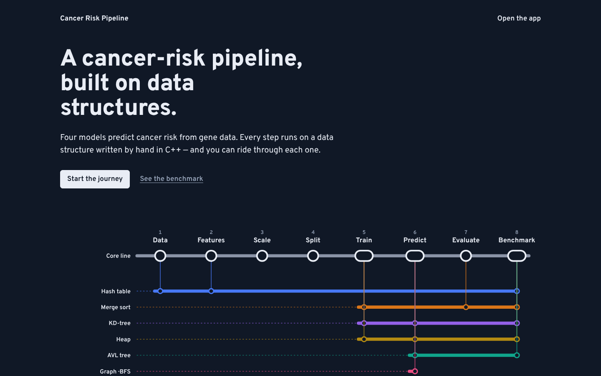 | 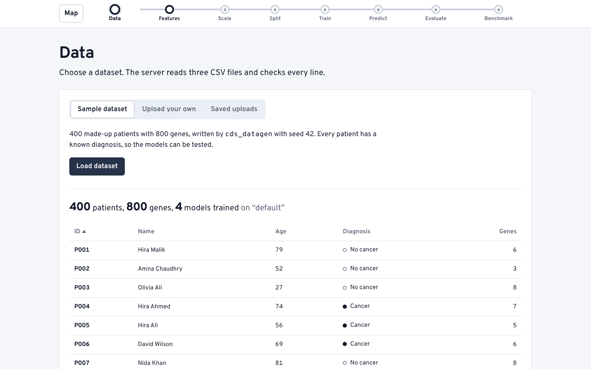 |
| 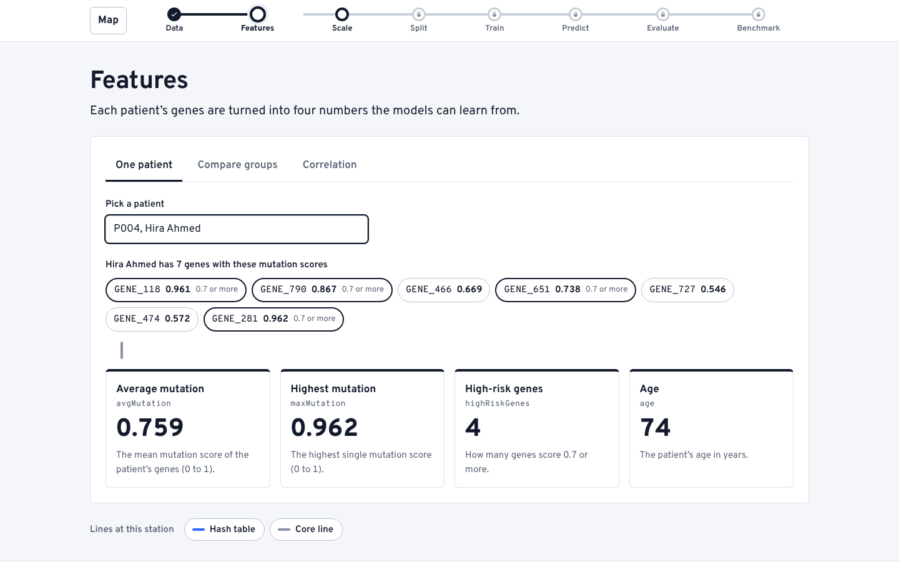 | 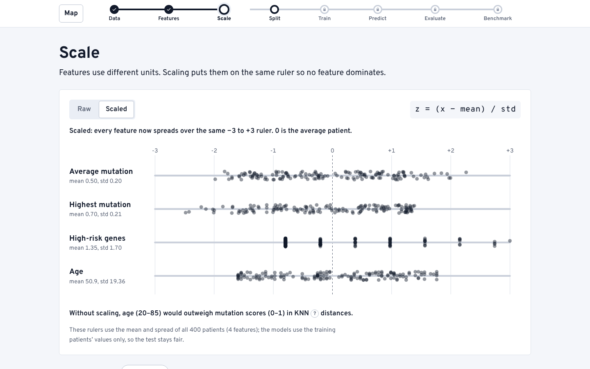 |
| 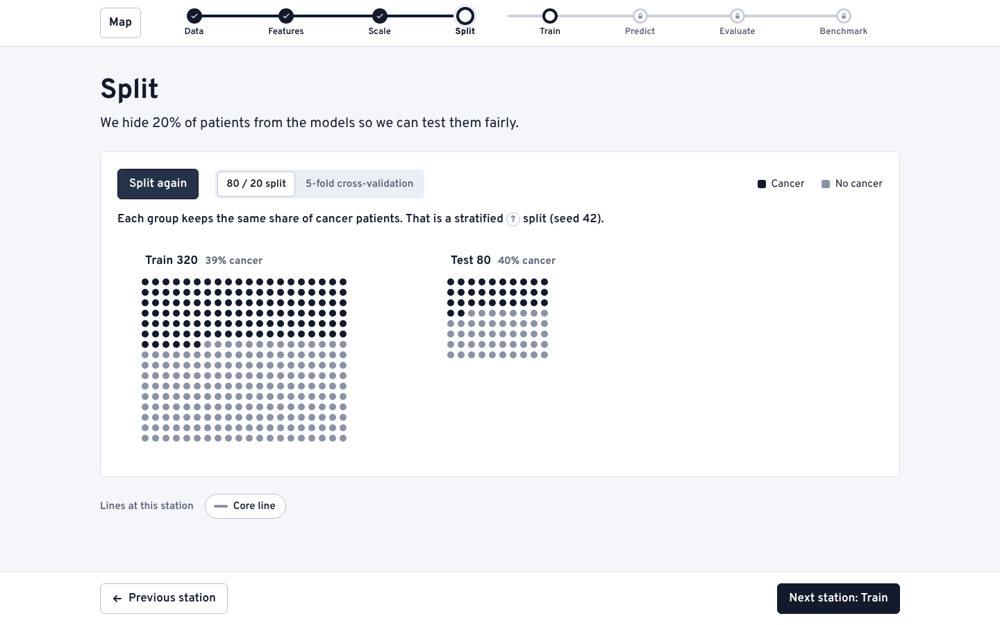 | 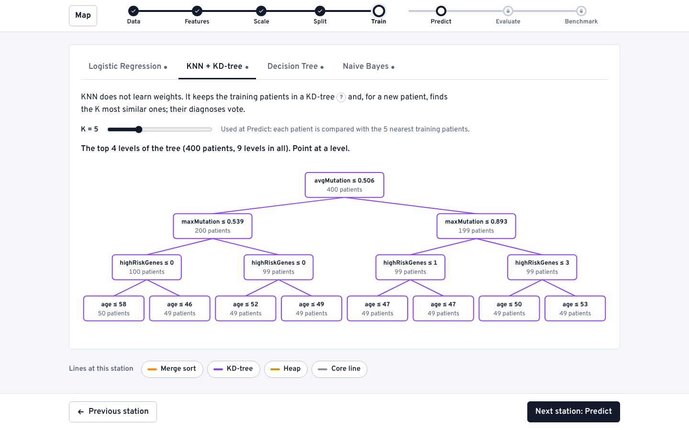 |
| 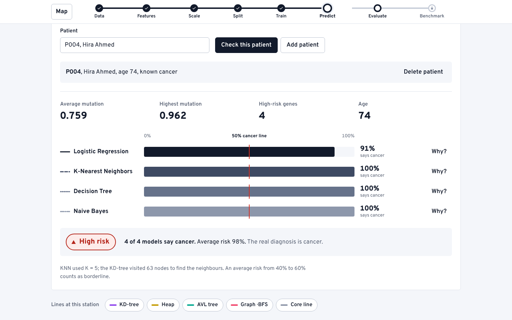 | 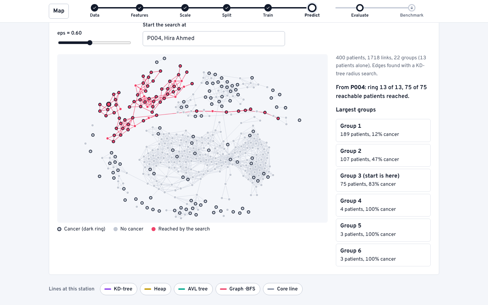 |
| 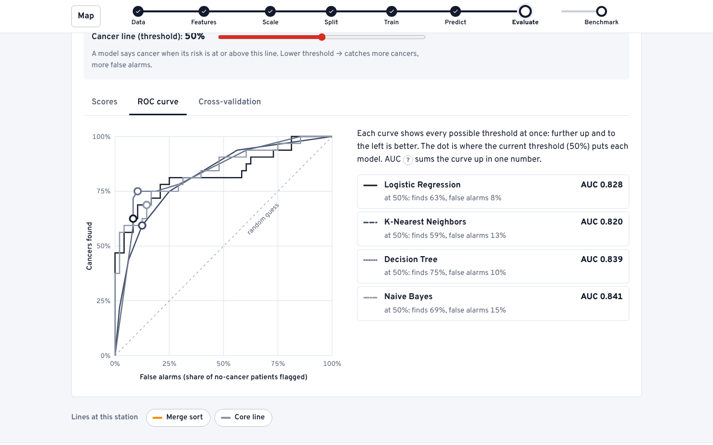 | 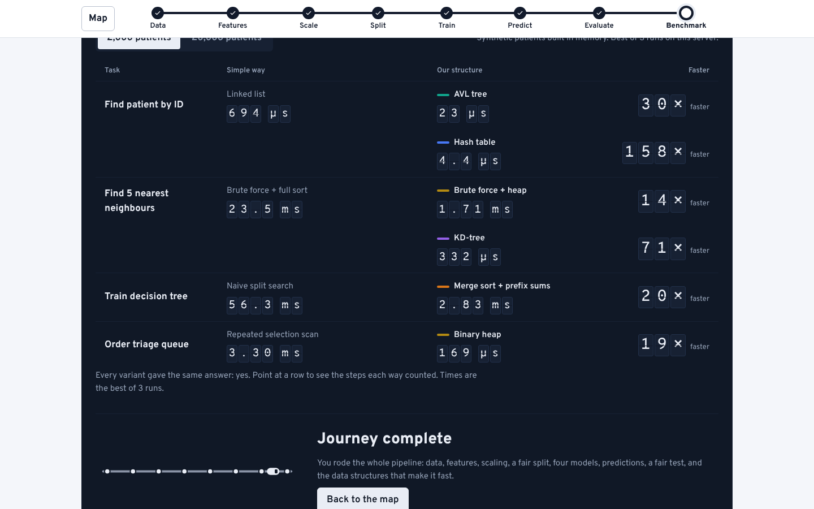 |
| 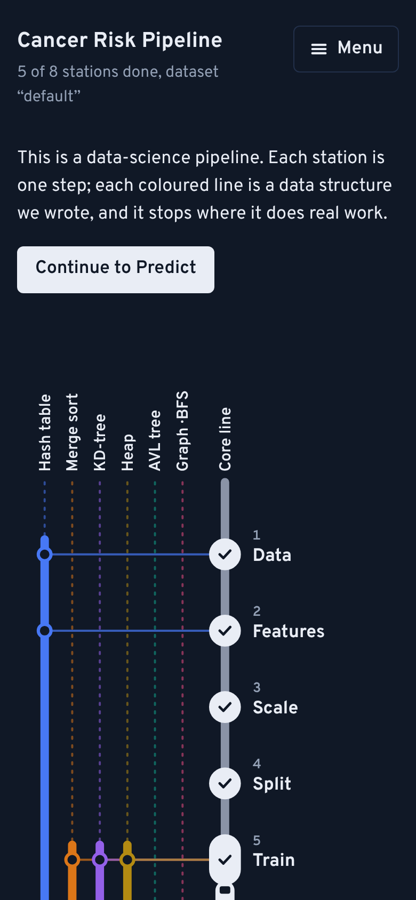 | 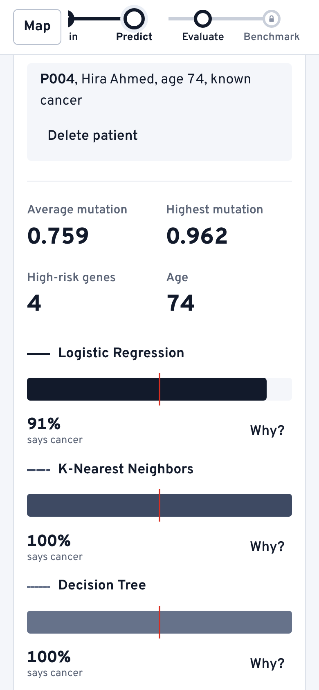 |

## 📝 License

This project is licensed under the MIT License - see the [LICENSE](LICENSE) file for details.

## 👤 Author

Abdul Rahman — https://github.com/Abdulrahman10724
