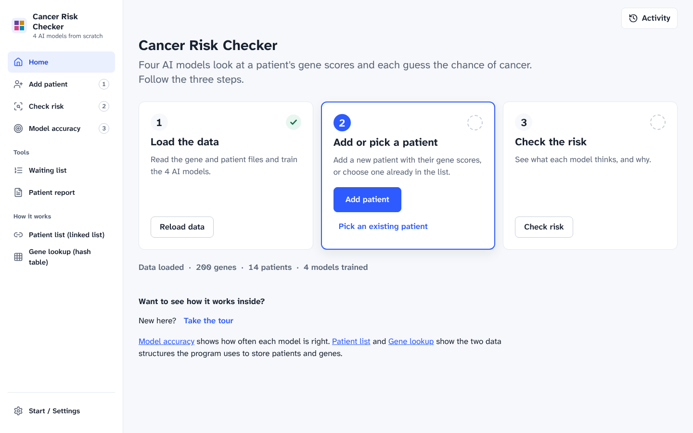
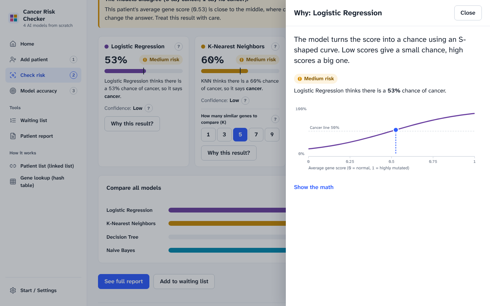
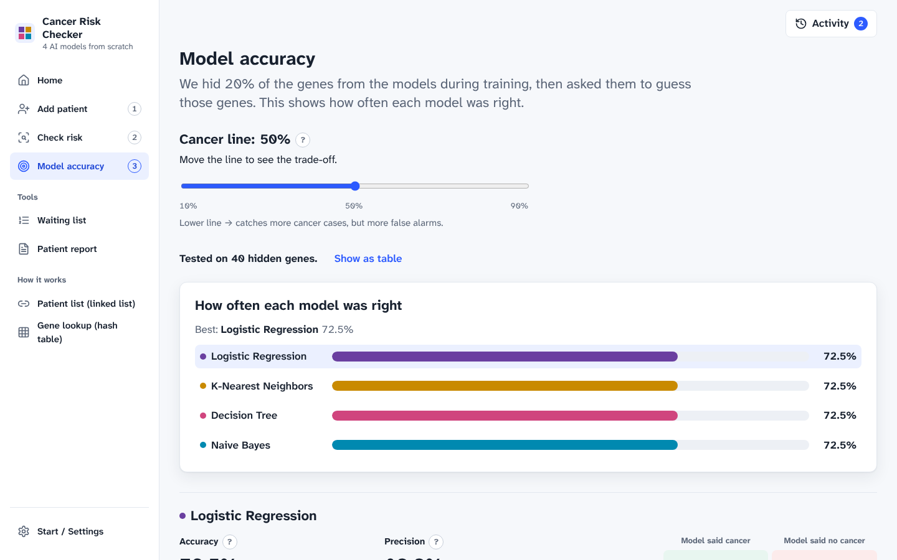
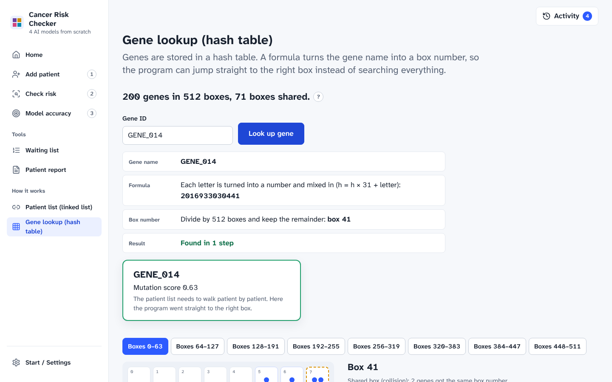

# 🔬 Cancer Diagnosis System

> **Cancer risk from genetic mutation scores with four machine learning models written from scratch in C++, and a React interface that shows, step by step, what each model does.**

[](https://en.cppreference.com/)
[](https://cmake.org/)
[](https://react.dev/)
[](LICENSE)

> **Student project — not for real medical use.**

> **Note:** Frontend is being updated to the new API. The C++ server now works with four
> features per patient (see [docs/API.md](docs/API.md)); some React screens still expect the
> old one-feature responses.


## 📋 Table of Contents

- [Overview](#-overview)
- [Features](#-features)
- [Design](#-design)
- [Tech Stack](#️-tech-stack)
- [Getting Started](#-getting-started)
- [Usage](#-usage)
- [Project Structure](#-project-structure)
- [API Documentation](#-api-documentation)
- [Machine Learning Models](#-machine-learning-models)
- [Data Structures](#-data-structures)
- [Data Format](#-data-format)
- [Screenshots](#-screenshots)
- [License](#-license)
- [Author](#-author)

## 🎯 Overview

The **Cancer Diagnosis System** predicts whether a patient's genes point to cancer. Each
patient has a few genes with a mutation score from 0 to 1. Each patient is turned into four
features (average mutation score, highest mutation score, number of high-risk genes, age),
and four models each return a risk between 0 and 1.

The project has two parts:

- A **C++17 HTTP server** (`cds_server`, port 8080) with four models implemented from
  scratch and the data structures the course asks for, each used for a real job.
- A **React frontend** (`frontend/`) that shows every result and explains how each model
  reached it.

### Key Highlights

- 🧠 **Four models from scratch**: Logistic Regression, K-Nearest Neighbors, Decision Tree and Naive Bayes
- 🧪 **Explained predictions**: for every model you can see the numbers behind its answer
- 📊 **Honest evaluation**: metrics on a held-out 20% split the evaluated models never trained on
- 🧱 **Hand-written data structures doing real work**: hash table, linked list, KD-tree, binary heap, merge sort with prefix sums, AVL trees, a similarity graph with BFS, and an undo stack — with a `/benchmark` endpoint that measures them against simpler alternatives
- 📚 **Docs**: [API reference](docs/API.md) and [data structures and algorithms](docs/DSA.md)

## ✨ Features

The app is written in plain words for people with no biology or machine-learning
background. Every screen starts with one sentence saying what it is for, and every
technical term has a "?" with a short explanation.

- **Home**: three steps (Load the data → Add or pick a patient → Check the risk), each
  ticked off as you complete it, plus a short guided tour on the first visit
- **Check risk** (main screen): the patient's gene scores flow into four model cards,
  each card fills its risk bar, and the final result counts the votes ("3 of 4 models
  say cancer"). Confidence (High / Medium / Low), a "models disagree" note, a comparison
  chart, a KNN "how many similar genes (K)" control and side-by-side comparison of two patients
- **Why this result?**: one animated picture per model: KNN's nearest genes voting, the
  decision tree's yes/no questions, logistic regression's S-curve and Naive Bayes' two hills
- **Add patient**: gene scores with sliders, a yes/no "linked to cancer?" answer and a live
  average; the models learn from the new genes
- **Model accuracy**: ranked accuracy, precision, recall and F1 on hidden test genes, a
  2×2 table in words (found cancer, missed cancer, false alarm, correctly said no cancer)
  and a "cancer line" slider that shows the trade-off
- **Waiting list** (queue), **Patient list** (linked list) and **Gene lookup** (hash table)
  animate how each data structure works
- **Patient report**: one printable page (Print / Save as PDF)
- **Activity**: a list of what happened, exportable as `.txt`

## 🎨 Design

A friendly, light medical-app style aimed at a first-year student or a teacher.

- **Plain language**: screens are named for what you do (Add patient, Check risk, Model
  accuracy). Results are sentences: "Naive Bayes thinks there is a 72% chance of cancer, so
  it says cancer."
- **Risk is never colour alone**: Low (green ✓, under 35%), Medium (amber !, 35–65%) and
  High (red ▲, over 65%) always show a word and an icon. These levels are for display; a
  model's own answer always uses the 50% cancer line.
- **Model colours** identify models only and always appear next to the model's name:
  Logistic Regression `#6A3FA0`, KNN `#C98A00`, Decision Tree `#D0457E`, Naive Bayes `#0089B0`.
  The risk colours are lighter than text needs, so risk *words* use darker shades
  (5.3:1 contrast or more); bars and icons use the bright colours.
- **Animation explains**: when you press Check risk, the steps the system takes are shown
  in order (reading the genes, each model deciding, the votes being counted). Every other
  animation answers something you did. With reduced motion turned on, results appear at once.
- **Type**: Atkinson Hyperlegible Next, a typeface designed for readability, with
  tabular figures for numbers.
- **Accessible**: keyboard access everywhere, visible focus, panels that trap focus and
  close on Esc, the final result announced to screen readers, and 4.5:1 text contrast.

## 🛠️ Tech Stack

### Backend
- **Language**: C++17
- **HTTP server**: [cpp-httplib](https://github.com/yhirose/cpp-httplib) v0.28.0 (single header in `third_party/`)
- **Build**: CMake 3.10+
- Thread-safe: every request handler locks one mutex around the shared system object
- No STL containers beyond `vector`/`string`: every map, set, queue, stack, heap and sort is written by hand

### Frontend
- **React 18** with **Vite**, React Router
- **framer-motion** (all animation), **d3-scale** (scales only; every chart is hand-drawn SVG), **lucide-react** (navigation icons)
- CSS Modules and one `tokens.css`; fonts from `@fontsource`

## 🚀 Getting Started

### Prerequisites

- **CMake** 3.10 or higher
- **C++17 compiler**: Visual Studio 2019+ or MinGW (Windows), GCC (Linux), Xcode Command Line Tools (macOS)
- **Node.js 18** or newer (for the frontend)

### 1. Clone

```bash
git clone https://github.com/Abdulrahman10724/Cancer-Diagnosis-System.git
```

```bash
cd Cancer-Diagnosis-System
```

### 2. Build the server

**Linux / macOS**
```bash
mkdir build && cd build
cmake .. -DCMAKE_BUILD_TYPE=Release
cmake --build .
```

**Windows (Visual Studio)**
```bash
mkdir build && cd build
cmake .. -G "Visual Studio 16 2019"
cmake --build . --config Release
```

**Windows with MinGW (MSYS2)**
```bash
mkdir build && cd build
cmake .. -G "MinGW Makefiles"
cmake --build .
# Executable: build\cds_server.exe
```

### 3. Run the server

Always run it from the project root, so it finds the `data/` folder:

```bash
./build/cds_server               # Linux/macOS
.\build\Release\cds_server.exe   # Windows (Visual Studio)
.\build\cds_server.exe           # Windows (MinGW)
```

### 4. Run the frontend

In a second terminal:

```bash
cd frontend
npm install
npm run dev
```

Open the URL Vite prints (normally http://localhost:5173). On **Home**, follow step 1 and choose
**Load data**. The server reads the CSV files and trains the four models.

The frontend talks to `http://localhost:8080` by default. To use another address, change
it on the Start screen (under Advanced), or set `VITE_API_URL` before `npm run dev`.

Other scripts: `npm run build` (production build in `frontend/dist/`) and `npm run lint`.

For more detail and troubleshooting, see [SETUP_GUIDE.md](SETUP_GUIDE.md).

### 5. Run the tests

The build also makes `cds_tests` (unit tests for every data structure and model). From the
`build` folder:

```bash
ctest --output-on-failure
```

With Visual Studio add the configuration: `ctest -C Release --output-on-failure`.

### 6. Generate a dataset (optional)

`cds_datagen` writes the three CSV files of a synthetic dataset:

```bash
./build/cds_datagen --patients 400 --genes 800 --seed 42 --noise 0.10 --out data --force
```

| Option | Default | Meaning |
|---|---|---|
| `--patients N` | 400 | number of patients |
| `--genes N` | 800 | number of genes |
| `--seed N` | 42 | random seed (the same seed gives the same files on every compiler) |
| `--noise X` | 0.10 | share of diagnoses flipped at random |
| `--out DIR` | `data` | output folder |
| `--force` | off | overwrite existing files |

The command above recreates the default dataset in `data/`. Datasets can also be uploaded
through `POST /upload` and switched with `POST /datasets/select`.

## 📖 Usage

1. **Home** shows three steps. A short tour points at each part on the first visit.
2. **Start**: press **Load data**. The checklist ticks off reading the files and training
   the 4 models.
3. **Add patient**: enter a patient and their gene scores, then **Save patient**.
4. **Check risk**: pick a patient and press **Check risk**. Press **Why this result?** on
   any model to see how it decided.
5. **Model accuracy**: see how often each model is right, and move the cancer line.
6. **Waiting list**, **Patient report**, **Patient list (linked list)** and **Gene lookup
   (hash table)** are in the sidebar (on a phone, under **More**).

## 📁 Project Structure

```
Cancer-Diagnosis-System/
├── data/
│   ├── genes.csv              # Genes: Gene_ID, Mutation_Score
│   ├── patients.csv           # Patients: Patient_ID, Name, Age, Diagnosis
│   ├── patient_genes.csv      # Which genes belong to which patient
│   ├── uploads/<name>/        # Uploaded datasets (created by POST /upload)
│   └── test_*.csv             # Old-format files, not used by the server
├── headers/                   # C++ headers (models, data structures, system)
├── src/                       # C++ sources; Server.cpp is the HTTP API
├── tests/test_main.cpp        # Unit tests (cds_tests, run with ctest)
├── tools/generate_data.cpp    # Dataset generator (cds_datagen)
├── third_party/httplib.h      # cpp-httplib
├── frontend/                  # React app
│   └── src/
│       ├── api/client.js      # The only place that calls the server
│       ├── state/AppState.jsx # App state (Context + useReducer)
│       ├── styles/            # tokens.css, global.css
│       ├── components/        # Shell (navigation), ModelCard, FinalResult, Explain, Risk, Tour, …
│       ├── screens/           # Home, Start, AddPatient, CheckRisk, Accuracy, WaitingList,
│       │                      # PatientReport, LinkedList, HashTable
│       ├── hooks/useRiskRun.js # Runs Check risk and its step-by-step animation
│       └── lib/               # metrics.js, format.js, models.js, hash.js, tour.js
├── docs/
│   ├── API.md                 # Every endpoint with request and response
│   ├── DSA.md                 # Data structures, complexities, benchmark results
│   └── screenshots/
├── generate_genes.py          # Old genes.csv generator (kept; replaced by cds_datagen)
├── main.cpp                   # Old command-line version (not built)
├── CMakeLists.txt
├── SETUP_GUIDE.md
└── README.md
```

## 🔌 API Documentation

The full reference with request and response shapes is in **[docs/API.md](docs/API.md)**.
The server listens on `http://localhost:8080`; every response, errors included, carries
`Access-Control-Allow-Origin: *`. Errors are `{"error":"..."}` with `400` (bad input, no data,
invalid dataset — then also `"problems":[...]`), `404` (unknown ID) or `409` (duplicate).

| Method | Path | Purpose |
|---|---|---|
| GET | `/status` | Active dataset, counts, whether the models are trained |
| POST | `/load` | Load CSV files by path |
| POST | `/upload` | Upload a dataset as CSV text; validated, saved to `data/uploads/<name>/`, loaded |
| GET | `/datasets` | `default` and every uploaded dataset, with counts |
| POST | `/datasets/select` | Switch to another dataset |
| GET / POST | `/patients` | List patients / add one (retrains and saves) |
| DELETE | `/patients/{id}` | Delete a patient |
| POST | `/undo` | Undo the last add or delete |
| GET | `/patients/search`, `/patients/index`, `/patients/range` | Linked-list search, AVL ID lookup, AVL risk range |
| GET | `/genetic` | All genes |
| GET | `/diagnose` | One model or all four, with explanations |
| GET | `/evaluate`, `/crossval` | 80/20 test metrics with ROC/AUC; k-fold cross-validation |
| GET | `/features`, `/tree`, `/kdtree` | Feature statistics and correlation; the decision tree; the KD-tree |
| GET / POST | `/queue`, `/queue/process` | FIFO waiting list |
| GET / POST | `/triage`, `/triage/process` | Priority queue by risk (binary heap) |
| GET | `/graph`, `/graph/bfs` | Patient similarity graph, components and BFS |
| GET | `/hashmap` | Buckets of the gene hash table |
| GET | `/benchmark?n=2000&seed=1` | Timings of the data structures against simpler alternatives |

## 🤖 Machine Learning Models

Every patient becomes four features (`src/FeatureExtractor.cpp`):

| Feature | Meaning |
|---|---|
| `avgMutation` | mean mutation score of the patient's genes |
| `maxMutation` | highest mutation score |
| `highRiskGenes` | number of genes with a score of 0.7 or more (`HIGH_RISK_CUTOFF`) |
| `age` | the patient's age |

Each feature is standardized with its own mean and standard deviation from the training
patients. The four models train on the labelled patients:

- **Logistic Regression**: gradient descent on log loss (learning rate 0.1, 2000 iterations), one weight per feature; risk = σ(w·x + b).
- **K-Nearest Neighbors**: K = 5, neighbours found with a KD-tree; risk = share of the K nearest patients with cancer.
- **Decision Tree**: Gini impurity, maximum depth 5, minimum 4 patients to split, split search with merge sort and prefix sums.
- **Naive Bayes**: one Gaussian per feature and class plus the class prior; risk = posterior probability of cancer.

On the default dataset (80/20 stratified split, seed 42): logistic regression 0.800 accuracy
(AUC 0.828), KNN 0.762 (0.820), decision tree 0.838 (0.839), Naive Bayes 0.787 (0.841).
5-fold cross-validation and the details are in [docs/DSA.md](docs/DSA.md).

## 🧱 Data Structures

All written by hand; [docs/DSA.md](docs/DSA.md) gives where each is used, why, the
complexity of every operation and measured benchmark numbers.

- **Linked list**: the patient list in insertion order
- **Hash table** (separate chaining, rehash at load factor 0.75): gene ID → mutation score
- **KD-tree**: KNN neighbour search and graph edge search
- **Binary heap**: KNN top-K and the triage priority queue
- **Merge sort + prefix sums**: decision-tree split search
- **AVL trees**: patient ID index and risk range index
- **Graph + BFS**: patient similarity clusters
- **Stack**: undo (up to 50 steps); **linked queue**: waiting list and BFS

## 📊 Data Format

A dataset is three CSV files. Loading is all-or-nothing: if any line is wrong, the server
answers `400` with a list of problems (at most 50) and keeps the dataset it had.

### patients.csv
```csv
Patient_ID,Name,Age,Diagnosis
P001,Hira Malik,79,0
P002,Amna Chaudhry,52,1
P003,New Patient,40,
```
`Diagnosis` is `1` (cancer), `0` (no cancer) or empty (unknown). At least 10 patients need
a diagnosis, with both values present. Age is a whole number from 0 to 120.

### genes.csv
```csv
Gene_ID,Mutation_Score
GENE_001,0.3745
GENE_002,0.7965
```
Scores are from 0 to 1. A third column (such as the old `Label`) is ignored.

### patient_genes.csv (required)
```csv
Patient_ID,Gene_ID
P001,GENE_312
P001,GENE_239
```
Every patient needs at least one gene, and every ID must exist in the other two files.

## 📸 Screenshots

| | |
|---|---|
|  |  |
|  |  |
|  |  |
|  |  |

## 📝 License

This project is licensed under the MIT License - see the [LICENSE](LICENSE) file for details.

## 👤 Author

Abdul Rahman — https://github.com/Abdulrahman10724
