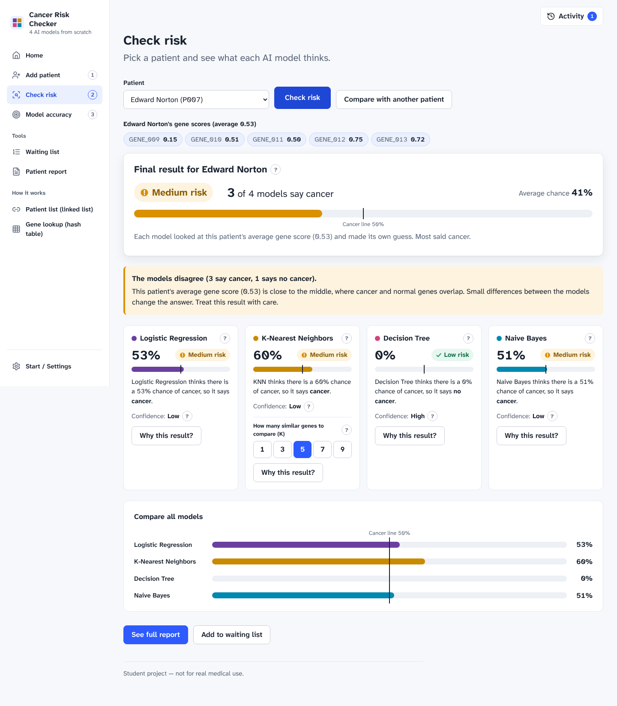
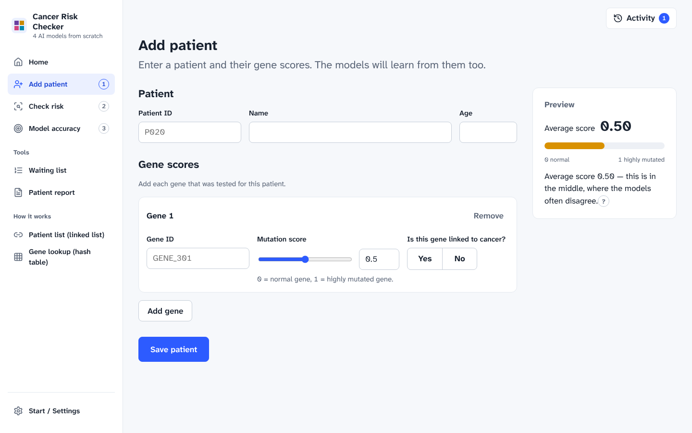
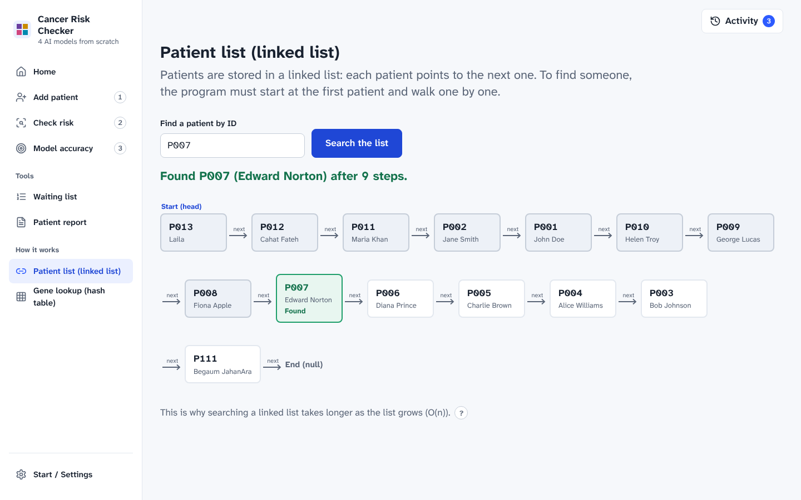
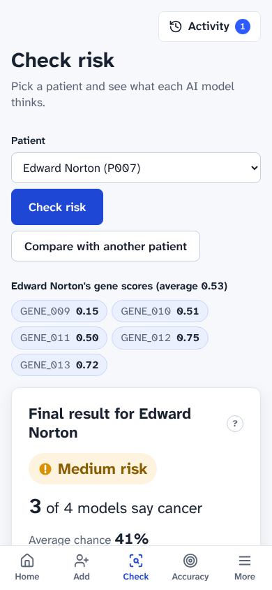

# 🔬 Cancer Diagnosis System

> **Cancer risk from genetic mutation scores with four machine learning models written from scratch in C++, and a React interface that shows, step by step, what each model does.**

[](https://en.cppreference.com/)
[](https://cmake.org/)
[](https://react.dev/)
[](LICENSE)

> **Student project — not for real medical use.**



## 📋 Table of Contents

- [Overview](#-overview)
- [Features](#-features)
- [Design](#-design)
- [Tech Stack](#️-tech-stack)
- [Getting Started](#-getting-started)
- [Usage](#-usage)
- [Project Structure](#-project-structure)
- [API Documentation](#-api-documentation)
- [Machine Learning Models](#-machine-learning-models)
- [Data Structures](#-data-structures)
- [Data Format](#-data-format)
- [Screenshots](#-screenshots)
- [License](#-license)
- [Author](#-author)

## 🎯 Overview

The **Cancer Diagnosis System** predicts whether a patient's genes point to cancer. Each
patient has a few genes with a mutation score from 0 to 1. The models look at the
patient's mean mutation score and return a risk between 0 and 1.

The project has two parts:

- A **C++17 HTTP server** (`cds_server`, port 8080) with four models implemented from
  scratch and the data structures the course asks for, each used for a real job.
- A **React frontend** (`frontend/`) that shows every result and explains how each model
  reached it.

### Key Highlights

- 🧠 **Four models from scratch**: Logistic Regression, K-Nearest Neighbors, Decision Tree and Naive Bayes
- 🧪 **Explained predictions**: for every model you can see the numbers behind its answer
- 📊 **Honest evaluation**: metrics on a held-out 20% split the evaluated models never trained on
- 🧱 **Data structures you can see**: the waiting list is a queue, the patient list a linked list and the gene lookup a hash table, each animated step by step

## ✨ Features

The app is written in plain words for people with no biology or machine-learning
background. Every screen starts with one sentence saying what it is for, and every
technical term has a "?" with a short explanation.

- **Home**: three steps (Load the data → Add or pick a patient → Check the risk), each
  ticked off as you complete it, plus a short guided tour on the first visit
- **Check risk** (main screen): the patient's gene scores flow into four model cards,
  each card fills its risk bar, and the final result counts the votes ("3 of 4 models
  say cancer"). Confidence (High / Medium / Low), a "models disagree" note, a comparison
  chart, a KNN "how many similar genes (K)" control and side-by-side comparison of two patients
- **Why this result?**: one animated picture per model: KNN's nearest genes voting, the
  decision tree's yes/no questions, logistic regression's S-curve and Naive Bayes' two hills
- **Add patient**: gene scores with sliders, a yes/no "linked to cancer?" answer and a live
  average; the models learn from the new genes
- **Model accuracy**: ranked accuracy, precision, recall and F1 on hidden test genes, a
  2×2 table in words (found cancer, missed cancer, false alarm, correctly said no cancer)
  and a "cancer line" slider that shows the trade-off
- **Waiting list** (queue), **Patient list** (linked list) and **Gene lookup** (hash table)
  animate how each data structure works
- **Patient report**: one printable page (Print / Save as PDF)
- **Activity**: a list of what happened, exportable as `.txt`

## 🎨 Design

A friendly, light medical-app style aimed at a first-year student or a teacher.

- **Plain language**: screens are named for what you do (Add patient, Check risk, Model
  accuracy). Results are sentences: "Naive Bayes thinks there is a 72% chance of cancer, so
  it says cancer."
- **Risk is never colour alone**: Low (green ✓, under 35%), Medium (amber !, 35–65%) and
  High (red ▲, over 65%) always show a word and an icon. These levels are for display; a
  model's own answer always uses the 50% cancer line.
- **Model colours** identify models only and always appear next to the model's name:
  Logistic Regression `#6A3FA0`, KNN `#C98A00`, Decision Tree `#D0457E`, Naive Bayes `#0089B0`.
  The risk colours are lighter than text needs, so risk *words* use darker shades
  (5.3:1 contrast or more); bars and icons use the bright colours.
- **Animation explains**: when you press Check risk, the steps the system takes are shown
  in order (reading the genes, each model deciding, the votes being counted). Every other
  animation answers something you did. With reduced motion turned on, results appear at once.
- **Type**: Atkinson Hyperlegible Next, a typeface designed for readability, with
  tabular figures for numbers.
- **Accessible**: keyboard access everywhere, visible focus, panels that trap focus and
  close on Esc, the final result announced to screen readers, and 4.5:1 text contrast.

## 🛠️ Tech Stack

### Backend
- **Language**: C++17
- **HTTP server**: [cpp-httplib](https://github.com/yhirose/cpp-httplib) v0.28.0 (single header in `third_party/`)
- **Build**: CMake 3.10+
- Thread-safe: every request handler locks one mutex around the shared system object

### Frontend
- **React 18** with **Vite**, React Router
- **framer-motion** (all animation), **d3-scale** (scales only; every chart is hand-drawn SVG), **lucide-react** (navigation icons)
- CSS Modules and one `tokens.css`; fonts from `@fontsource`

## 🚀 Getting Started

### Prerequisites

- **CMake** 3.10 or higher
- **C++17 compiler**: Visual Studio 2019+ or MinGW (Windows), GCC (Linux), Xcode Command Line Tools (macOS)
- **Node.js 18** or newer (for the frontend)

### 1. Clone

```bash
git clone https://github.com/Abdulrahman10724/Cancer-Diagnosis-System.git
```

```bash
cd Cancer-Diagnosis-System
```

### 2. Build the server

**Linux / macOS**
```bash
mkdir build && cd build
cmake .. -DCMAKE_BUILD_TYPE=Release
cmake --build .
```

**Windows (Visual Studio)**
```bash
mkdir build && cd build
cmake .. -G "Visual Studio 16 2019"
cmake --build . --config Release
```

**Windows with MinGW (MSYS2)**
```bash
mkdir build && cd build
cmake .. -G "MinGW Makefiles"
cmake --build .
# Executable: build\cds_server.exe
```

### 3. Run the server

Always run it from the project root, so it finds the `data/` folder:

```bash
./build/cds_server               # Linux/macOS
.\build\Release\cds_server.exe   # Windows (Visual Studio)
.\build\cds_server.exe           # Windows (MinGW)
```

### 4. Run the frontend

In a second terminal:

```bash
cd frontend
npm install
npm run dev
```

Open the URL Vite prints (normally http://localhost:5173). On **Home**, follow step 1 and choose
**Load data**. The server reads the CSV files and trains the four models.

The frontend talks to `http://localhost:8080` by default. To use another address, change
it on the Start screen (under Advanced), or set `VITE_API_URL` before `npm run dev`.

Other scripts: `npm run build` (production build in `frontend/dist/`) and `npm run lint`.

For more detail and troubleshooting, see [SETUP_GUIDE.md](SETUP_GUIDE.md).

## 📖 Usage

1. **Home** shows three steps. A short tour points at each part on the first visit.
2. **Start**: press **Load data**. The checklist ticks off reading the files and training
   the 4 models.
3. **Add patient**: enter a patient and their gene scores, then **Save patient**.
4. **Check risk**: pick a patient and press **Check risk**. Press **Why this result?** on
   any model to see how it decided.
5. **Model accuracy**: see how often each model is right, and move the cancer line.
6. **Waiting list**, **Patient report**, **Patient list (linked list)** and **Gene lookup
   (hash table)** are in the sidebar (on a phone, under **More**).

## 📁 Project Structure

```
Cancer-Diagnosis-System/
├── data/
│   ├── genes.csv              # Genetic records: Gene_ID, Mutation_Score, Label
│   ├── patients.csv           # Patients: Patient_ID, Name, Age
│   ├── patient_genes.csv      # Which genes belong to which patient
│   └── test_*.csv             # Extra test datasets
├── headers/                   # C++ headers (models, data structures, system)
├── src/                       # C++ sources; Server.cpp is the HTTP API
├── third_party/httplib.h      # cpp-httplib
├── frontend/                  # React app
│   └── src/
│       ├── api/client.js      # The only place that calls the server
│       ├── state/AppState.jsx # App state (Context + useReducer)
│       ├── styles/            # tokens.css, global.css
│       ├── components/        # Shell (navigation), ModelCard, FinalResult, Explain, Risk, Tour, …
│       ├── screens/           # Home, Start, AddPatient, CheckRisk, Accuracy, WaitingList,
│       │                      # PatientReport, LinkedList, HashTable
│       ├── hooks/useRiskRun.js # Runs Check risk and its step-by-step animation
│       └── lib/               # metrics.js, format.js, models.js, hash.js, tour.js
├── docs/screenshots/
├── generate_genes.py          # Generates a realistic genes.csv
├── main.cpp                   # Optional command-line version
├── CMakeLists.txt
├── SETUP_GUIDE.md
└── README.md
```

## 🔌 API Documentation

The server listens on `http://localhost:8080`. Every response carries
`Access-Control-Allow-Origin: *`. Errors are JSON: `{"error":"..."}`, with `400` for bad
input or when no data is loaded (`{"error":"Load data first"}`), `404` for unknown IDs and
`409` for a duplicate patient ID.

| Method | Path | Purpose |
|---|---|---|
| GET | `/status` | `modelsTrained`, `geneticCount`, `patientCount` |
| POST | `/load` | Load CSV files and train. Body: `{"genesFile":"data/genes.csv","patientsFile":"data/patients.csv"}` (optional `patientGenesFile`) |
| GET | `/patients` | Patients in linked-list order (head first), with `riskScore`, `prediction` and their `genes` |
| POST | `/patients` | Add a patient: `{"patient_id","name","age","geneticRecords":[{"geneId","mutationScore","label"}]}`. Retrains, saves the CSV files |
| GET | `/patients/search?id=ID` | Linear search of the linked list |
| GET | `/genetic` | All genetic records |
| GET | `/diagnose?patient_id=ID&model=M&k=K` | Diagnose one patient |
| GET | `/evaluate` | Metrics on a held-out 20% split, with per-sample data |
| GET | `/hashmap` | Buckets of the mutation hash table |
| GET | `/queue` | Queued patient IDs, front first |
| POST | `/queue` | Add a patient to the rear: `{"patient_id":"P001"}` |
| POST | `/queue/process` | Process the whole queue: `{"model":"logistic"}` |

### `GET /diagnose`

`model` is `logistic`, `knn`, `decision_tree`, `naive_bayes` (single model, returns
`{"patient_id","riskScore","prediction"}`) or `all`. `k` is optional (odd, 1–15, default 5)
and changes K for KNN for this request only.

`model=all` returns all four models with the numbers behind each answer:

```json
{
  "patient_id": "P007",
  "featureRaw": 0.52578,
  "featureScaled": 0.179608,
  "scale": { "mean": 0.487289, "std": 0.214304 },
  "geneCount": 5,
  "threshold": 0.5,
  "models": {
    "logistic": { "risk": 0.529, "prediction": 1, "explain": { "weight": 0.9475, "bias": -0.0531, "z": 0.117 } },
    "knn": { "risk": 0.6, "prediction": 1, "k": 5,
             "explain": { "neighbors": [ { "gene_id": "GENE_076", "mutation_score": 0.5215, "label": 0, "distance": 0.02 } ],
                          "votesCancer": 3, "votesSafe": 2 } },
    "decision_tree": { "risk": 0.0, "prediction": 0,
                       "explain": { "path": [ { "threshold": 0.527, "thresholdScaled": 0.1855, "wentLeft": true, "positiveFraction": 0.485, "samples": 206 } ],
                                    "leafPositiveFraction": 0.0, "leafSamples": 3 } },
    "naive_bayes": { "risk": 0.514, "prediction": 1,
                     "explain": { "safe": { "mean": -0.46, "std": 0.83, "prior": 0.51 },
                                  "cancer": { "mean": 0.49, "std": 0.94, "prior": 0.49 } } }
  },
  "consensus": { "cancer": 3, "safe": 1 }
}
```

`featureRaw` is the patient's mean mutation score (what the models see), `featureScaled`
the same value after standardization. KNN neighbour `mutation_score` values are raw;
`distance` is measured in the scaled space the model uses. Decision-tree `threshold` is on
the raw score scale and `thresholdScaled` is the value the tree actually compares.

### `GET /evaluate`

The genetic data is split 80% train / 20% test, stratified by label, with a fixed seed.
Temporary copies of the models train on the 80% and are measured on the 20%; the models
used by `/diagnose` stay trained on all the data. Predictions use `risk >= 0.5`.

```json
{
  "testSamples": 41,
  "models": [
    { "key": "logistic", "name": "Logistic Regression",
      "accuracy": 0.7561, "precision": 0.8125, "recall": 0.65, "f1": 0.7222,
      "confusion": { "tp": 13, "fp": 3, "tn": 18, "fn": 7 },
      "samples": [ { "gene_id": "GENE_001", "mutation_score": 0.3633, "label": 0, "risk": 0.3503 } ] }
  ]
}
```

The frontend recomputes the metrics for other thresholds from `samples`.

### `GET /hashmap`

```json
{ "bucketCount": 512, "size": 206, "loadFactor": 0.4023,
  "buckets": [ { "index": 0, "items": [] },
               { "index": 7, "items": [ { "key": "GENE_001", "value": 0.3633, "hash": 2016933030407 },
                                         { "key": "GENE_122", "value": 0.4271, "hash": 2016933031431 } ] } ] }
```

Hash values above 2^53 lose precision as JSON numbers in JavaScript; the frontend
recomputes the exact hash with `BigInt` (`frontend/src/lib/hash.js`).

### `GET /patients/search?id=ID`

```json
{ "found": true, "hops": 9, "order": ["P013","P012","P011","P002","P001","P010","P009","P008","P007"] }
```

`order` lists every node visited from the head, in order.

## 🤖 Machine Learning Models

All four use one feature: the patient's mean mutation score, standardized with the mean
and standard deviation of the training genes.

- **Logistic Regression**: gradient descent on log loss (learning rate 0.01, 1000 iterations); risk = σ(w·x + b).
- **K-Nearest Neighbors**: Euclidean distance; risk = share of the K nearest training genes labelled cancerous (K = 5 by default).
- **Decision Tree**: Gini impurity, maximum depth 10; risk = share of cancerous training genes in the leaf the patient reaches.
- **Naive Bayes**: one Gaussian per class plus the class prior; risk = posterior probability of the cancerous class.

## 🧱 Data Structures

- **Linked list** (`PatientNode`): patient history. Searching walks the list from the head, O(n).
- **Queue** (`std::queue<Patient>`): test requests, first in, first out.
- **Hash table** (`HashMapper`): gene ID → mutation score. A separate-chaining hash table
  implemented in this project: a vector of buckets, each a linked list of (key, value)
  pairs; polynomial rolling hash `h = h * 31 + c` (unsigned 64-bit) modulo the bucket
  count; starts with 16 buckets and doubles when the load factor passes 0.75.
- **Vector**: the genetic records used for training.

## 📊 Data Format

### genes.csv
```csv
Gene_ID,Mutation_Score,Label
GENE_001,0.3633,0
GENE_003,0.7553,1
```

### patients.csv
```csv
Patient_ID,Name,Age
P001,John Doe,45
```

### patient_genes.csv
Links each patient to its own genes by `Gene_ID`. The server writes it whenever it saves.
If the file does not exist, each patient is given 5 consecutive genes from `genes.csv`.
```csv
Patient_ID,Gene_ID
P001,GENE_001
P001,GENE_002
```

## 📸 Screenshots

| | |
|---|---|
|  |  |
|  |  |
|  |  |
|  |  |

## 📝 License

This project is licensed under the MIT License - see the [LICENSE](LICENSE) file for details.

## 👤 Author

Abdul Rahman — https://github.com/Abdulrahman10724
